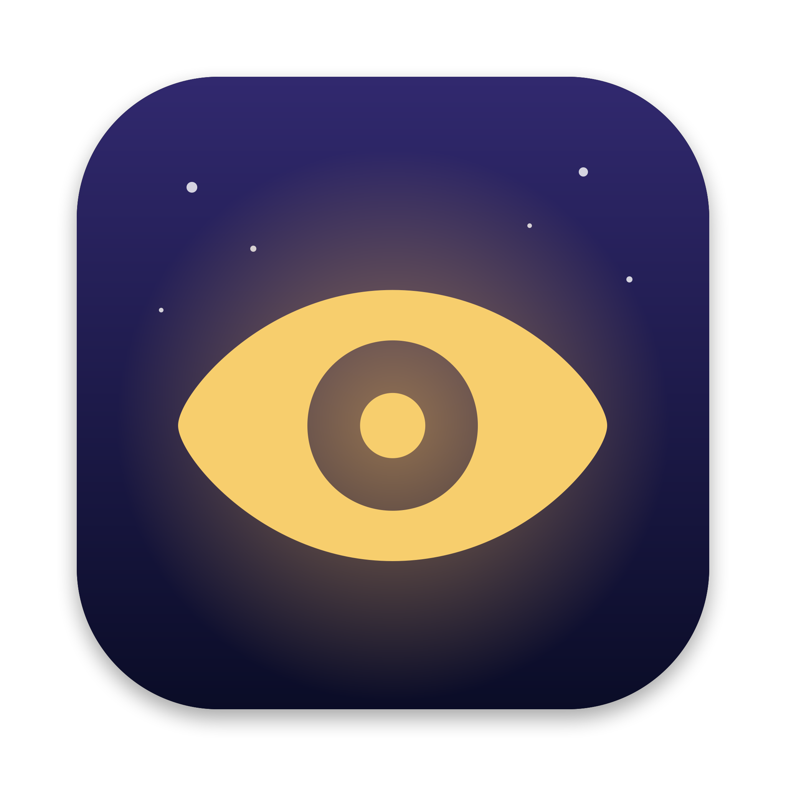

<p align="center"></p>

# OwlEye

A tiny macOS menu bar app that keeps your Mac running **with the lid closed** for as long as you choose, so AI coding agents (Claude Code, Codex, …) keep working while you sleep.

Click the eye, pick a time, confirm with **Touch ID** (or your password), close the lid.

## Built to be trusted

- **Lives only on your Mac.** No account, no network calls, no analytics, no updater. About 350 lines of Swift and shell you can read in ten minutes.
- **No passwordless sudo.** OwlEye never edits `/etc/sudoers` and installs no root helper or launch daemon. Every session asks again: Touch ID, or your password if Touch ID is not available or you cancel it.
- **Sleep always comes back.** The root part is a short shell loop (see [`Watchdog.swift`](Sources/OwlEye/Watchdog.swift)) that turns normal sleep back on when:
  - the timer ends
  - you press **Stop**
  - OwlEye quits, crashes or is force-quit
  - the charger is unplugged (on by default)
  - on battery, the charge drops below 20% (optional)

  If sleep is still off when OwlEye launches, it asks to restore it.
- **Dark when closed.** When the lid closes, the watchdog runs `pmset displaysleepnow`, so the screen and keyboard light go off while the Mac keeps working.

When you open the lid in the morning you will see the lock screen (with the live wallpaper if you use one). That is normal: the display slept and the screen locked, but the Mac itself stayed awake. `~/Library/Logs/OwlEye.log` shows when the session started, when the lid closed and opened, and when sleep was restored.

## Use

1. Click the eye in the menu bar.
2. Pick **1h / 2h / 4h / 8h / Until I stop**, or set a custom time.
3. Confirm with Touch ID or your password.
4. The eye fills in and the menu bar shows the time left. Close the lid.

Keep the laptop on a hard, open surface. A closed MacBook doing real work gets warm.

## Turn on Touch ID for sudo (one time, optional)

OwlEye asks for permission through `sudo`. macOS ships with Touch ID for `sudo` switched off; without it you get a password dialog instead. To switch it on, using Apple's own template:

```sh
sed 's/^#auth/auth/' /etc/pam.d/sudo_local.template | sudo tee /etc/pam.d/sudo_local
```

This also lets you use your fingerprint for `sudo` in Terminal. It survives macOS updates. To undo it: `sudo rm /etc/pam.d/sudo_local`.

## How it works

`pmset -a disablesleep 1` is the only macOS setting that keeps a laptop awake with the lid shut (`caffeinate` cannot). When you start a session, OwlEye runs

```
sudo -k /bin/sh -c '<watchdog script>'
```

- `-k` ignores any cached sudo login, so every session asks again.
- The first try is plain `sudo`, which shows the Touch ID prompt.
- If you cancel Touch ID, or it is not available (lid closed, Touch ID for sudo not turned on), OwlEye asks again with `sudo -k -A`. `-A` uses [`askpass.sh`](Resources/askpass.sh) to show a password dialog. The password goes straight to `sudo` and is never stored. (`-A` also disables Touch ID, which is why it is only the fallback.)

The watchdog checks every 5 seconds and runs `pmset -a disablesleep 0` the moment any stop condition is met. **Stop** needs no password: OwlEye drops a file in `~/Library/Application Support/OwlEye/` and the watchdog sees it.

Check the state yourself at any time:

```sh
pmset -g | grep SleepDisabled   # "1" during a session, absent otherwise
```

## Build and install

Needs macOS 14+ and Swift 6 (the Xcode Command Line Tools are enough).

```sh
./build.sh            # builds build.noindex/OwlEye.app (hidden from Spotlight)
./build.sh --install  # also copies it to ~/Applications
```

Open the copy in `~/Applications`. Diagnostics go to `~/Library/Logs/OwlEye.log`.

The app is ad-hoc signed, so the first time you open it macOS may ask you to confirm in **System Settings → Privacy & Security → Open Anyway**.

The icon is drawn in code: `./tools/make-icon.sh` regenerates `Resources/AppIcon.icns`.

## License

MIT
